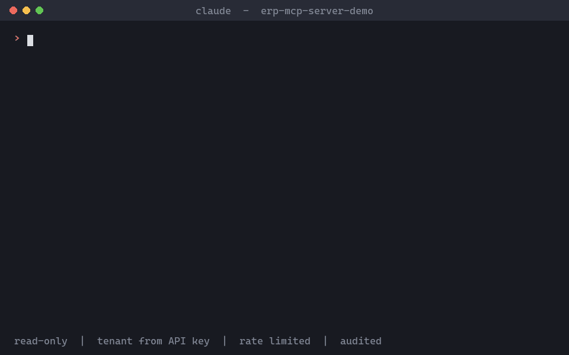
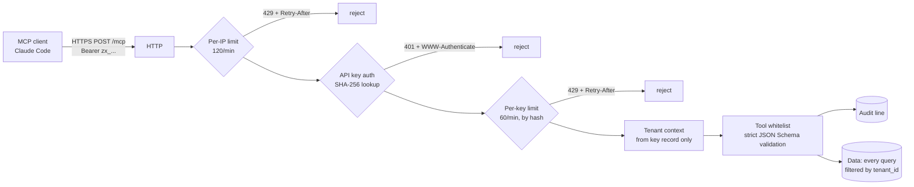

# erp-mcp-server-demo

**A read-only MCP server that lets a small-business owner ask Claude about sales, stock, cash and receivables, with per-key auth, hard tenant isolation, rate limits and an audit trail.**

> Sanitized demo of a production feature I built for a real multi-tenant ERP (Peru: PEN/USD, 18% IGV). All data here is fake, the code is rewritten from scratch.

<!-- TODO: replace with a 10-second GIF or screenshot of Claude answering "what is running low on stock?" -->


TypeScript, Node 20, official `@modelcontextprotocol/sdk`, Streamable HTTP (stateless, JSON responses) plus a stdio entry point, SQLite, Zod, Vitest, fast-check. **74 tests.**

## Architecture



## Security design

| Decision | Why |
|---|---|
| **Personal API key `zx_` + 40 base62 chars**, only the **SHA-256 hash** is stored, shown once at creation | A database leak must not leak usable credentials. The key is random with ~238 bits of entropy, so a fast hash is enough (no need for bcrypt). |
| **Max 5 active keys per user**; revoked or expired keys get `401` + `WWW-Authenticate: Bearer` | Bounds the blast radius of forgotten keys. The client can't tell *why* a key failed (malformed, unknown, revoked, expired all look the same). |
| **Tenant comes only from the key record**, never from headers or tool arguments | The classic multi-tenant bug is trusting `x-org-id`. Here nothing reads it, and tools use strict schemas so a smuggled `organizationId` argument is rejected. Tests spoof the headers and prove they are ignored. |
| **Per-IP limit (120/min) is checked before key validation**, then a per-key limit (60/min) keyed by the key **hash**. `429` + `Retry-After` | Invented keys can't hammer the key store (a test shows the throttled requests never reach it), and the raw key never sits in a memory map or log. |
| **Fixed whitelist of 7 read-only tools**, inputs validated against strict schemas before anything runs. No write tools at all | The model can only do what is listed. The JSON Schema advertised in `tools/list` is generated from the same Zod schema that validates the call, so docs and enforcement can't drift. Tools also carry `readOnlyHint`. |
| **One audit line per tool call**: key prefix, org, tool, duration, ok/error | Answers "who asked what, when" without storing secrets. It never contains the key or the arguments (tested), and unknown tool names are not echoed into logs. |
| **Money in integer cents**, IGV split as `base + tax == total` | No float rounding bugs. Property tests (fast-check) check the invariants over random amounts. |
| Body parsed only after auth, 100 KB limit, loopback bind, no stack traces to clients | Anonymous callers can't make the server do work. |

## Tools

| Tool | What it answers |
|---|---|
| `get_sales_summary(from, to)` | Documents, total, IGV base/tax, average ticket, by payment method |
| `get_top_products(from, to, limit?)` | Best sellers by revenue |
| `get_low_stock_products(threshold?)` | What is running out |
| `get_cash_register_status()` | Opening, cash sales, in/out, expected cash in drawer |
| `get_receivables_summary(overdueOnly?)` | Outstanding vs overdue, oldest overdue age |
| `list_receivables(page?, pageSize?)` | Open invoices, oldest first |
| `search_products(query)` | Price and stock by name or SKU |

Every result carries its `currency` and money as `{ cents, display }` (e.g. `{ "cents": 123450, "display": "S/ 1,234.50" }`).

## Quickstart

Requires Node 20+.

```bash
npm install
npm run seed                                            # fake data for two tenants
npm run keys:create -- --tenant cafe-arequipa --name my-laptop   # prints the key ONCE
npm start                                               # http://127.0.0.1:3333/mcp
```

Tenants: `cafe-arequipa` (coffee shop, PEN) and `compu-lima` (computer store, USD).

Connect Claude Code:

```bash
claude mcp add --transport http erp-demo http://localhost:3333/mcp --header "Authorization: Bearer <key>"
```

Things to ask:

- "What were my sales last week, and how much of it was IGV?"
- "Which products are running low on stock?"
- "What are my 5 best sellers this month?"
- "How much cash should be in the drawer right now?"
- "Who owes me money and what is overdue? Who is the oldest?"
- "How much does the 1kg bag of beans cost and how many do I have?"

Try the isolation: create a key for `compu-lima` too and notice it can never see the coffee shop's data (and vice versa).

stdio (no HTTP) is also supported: `ERP_API_KEY=<key> npm run start:stdio`. Audit lines go to stderr so they never corrupt the protocol stream.

Config: `PORT` (default 3333), `ERP_DB_PATH` (default `data/erp.db`), `TRUST_PROXY` (hop count, only behind a proxy you control).

## Tests

```bash
npm test            # 74 tests, ~5 s
npm run typecheck   # tsc --noEmit
```

| File | Covers |
|---|---|
| `tests/auth.test.ts` | Key format, hash-only storage, 5-key cap, revoked/expired, 401 + `WWW-Authenticate`, tool list is read-only |
| `tests/tenant-isolation.test.ts` | Tenant A never sees tenant B across all tools, spoofed `x-org-id` ignored, smuggled tenant arguments rejected |
| `tests/rate-limit.test.ts` | 120/min per IP before key lookup, 60/min per key, `Retry-After`, window reset, buckets keyed by hash |
| `tests/validation-and-audit.test.ts` | Invalid inputs per tool, unknown tools, SQL-looking input, audit lines never hold key or arguments |
| `tests/money.test.ts` | fast-check properties: `base + tax == total`, tax non-negative and within half a cent of exact, monotonic base, period sums without drift, format round-trip |
| `tests/tools.test.ts` | Results cross-checked against independent SQL, pagination, and an end-to-end run with the official MCP client |

CI: `.github/workflows/ci.yml` runs typecheck and tests on Node 20 and 22.

## Honest limitations and Roadmap

- **claude.ai and ChatGPT connectors need OAuth.** They don't let you paste a static `Authorization` header, so this key-based design works with Claude Code, Claude Desktop (via config) and other header-capable clients today. OAuth 2.1 (authorization server, dynamic client registration, scoped tokens) is the main roadmap item.
- Rate limiting is in-memory and per process. Behind several instances you would move the counters to Redis.
- Fixed-window counters allow short bursts at window edges; a sliding window or token bucket would be smoother.
- Demo stock numbers are static and not decremented by the fake sales.
- Roadmap: OAuth, key rotation endpoint, per-tool scopes, Redis rate limiter, structured log shipping.

## License

MIT, see [LICENSE](LICENSE).
